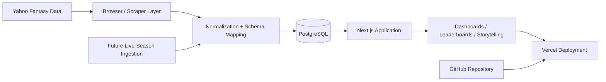

# From League Data to a Decision-Making Platform: How Claude Code Helped Build Chia League

## Executive summary

This project began with a simple operational problem: our fantasy football league had years of historical data, but no durable system for understanding it at scale. The information existed across spreadsheets, scattered records, and memory, making it difficult to answer even basic questions about league history, manager performance, or season-to-season patterns.

The goal was not simply to build another scoreboard. The goal was to create a trustworthy, maintainable platform that could convert league history into insight. The result is Chia League: a data-driven fantasy football app that combines historical records, performance analytics, season storytelling, and a live-season-ready architecture.

What made this project distinctive was the way it was built. Rather than treating the app as a one-off portfolio project, I designed it as a system with clean data boundaries, durable schema choices, and a clear separation between historical analytics and future live-season ingestion. Claude Code played a central role in accelerating the design and implementation process without replacing the need for disciplined technical decisions.

The result is a product that is useful to league participants, but also representative of a broader lesson in modern data work: when source data is fragmented, identity is unstable, and the product needs to evolve over time, the solution is not more dashboards—it is a better data model.

## The business problem

At a practical level, the league had all of the ingredients of a data problem:

- years of matchup history
- team and owner identity changes over time
- player-level statistics spread across seasons
- increased demand for better storytelling and league context
- recurring questions about performance trends and historical comparisons

The challenge was not just collecting data. The challenge was turning fragmented league history into a dependable, reusable source of truth.

In business terms, this is a classic data architecture issue. You do not get value from historical data if it is stored in disconnected artifacts and cannot be trusted for cross-season analysis. You need a system that preserves identity, normalizes records, and provides consistent key metrics over time.

That is where the project began: as a need for a better analytical foundation, not just a nicer interface.

## The strategic objective

The product was designed around a clear strategic objective: create a league intelligence layer that could answer questions faster and more reliably than the league’s informal record-keeping could.

The app needed to support several use cases:

- all-time manager comparisons
- season-by-season trend analysis
- playoff and championship storytelling
- weekly and cumulative performance tracking
- live-season readiness without premature assumptions

The deeper idea was to build not just a dashboard, but an information system that could support decision-making and storytelling at the same time.

## The core design decision: stable identity over changing labels

One of the most important design choices in the project was choosing owner identity as the stable business key rather than team name.

This is not a minor implementation detail. It is foundational.

Fantasy leagues often change team names, rebrands, and presentation styles over time. If the data model treats a team label as the primary identity, historical records become unstable, duplicate, and difficult to interpret. By modeling owners as the enduring entity while keeping team names as seasonal context, the platform preserves meaningful historical continuity.

That principle appears in the schema design:

- owners remain the stable identity
- teams_by_season captures a team name for each season
- weekly_matchups captures matchup outcomes and points by owner
- player_weekly_stats preserves player performance tied to team ownership

This design is both analytically sound and operationally wise. It makes the data easier to trust, the analytics easier to compare, and the product easier to extend over time.

## A disciplined architecture, not a fragile prototype

A common failure mode in side projects is building a fast UI on top of messy or ad hoc data. This project consciously avoided that trap.

The system is structured around clear layers:

1. Raw data collection
2. Normalization and schema mapping
3. Storage in PostgreSQL
4. Query-driven dashboards and reporting
5. Deployment through Vercel

This is not theoretical elegance. It is operational discipline.

The project treats the source data as a raw feed, not as the actual product. The product is the normalized, trusted representation of league performance. This separation matters because it allows the system to remain stable even when the data source changes or a new season introduces different collection conditions.

## The data model as a product decision

The app is built on a relational schema rather than a loose collection of JSON or ad hoc views. That is intentional.

Why relational modeling matters here:

- it captures the historical continuity of owners across seasons
- it supports comparisons across multiple seasons without conflating identity
- it allows for robust trends, cumulative metrics, and matchup-based analyses
- it prevents the reporting layer from carrying the complexity of the data model itself

The database is not a back-end afterthought. It is the product’s foundation.

This is an important distinction: a dashboard that is fed by noisy or poorly modeled data will always struggle to produce trustworthy insight. A strong data model reduces ambiguity and makes the analysis understandable to both users and future maintainers.

## Why this project was a good fit for AI-assisted development

Claude Code accelerated the project in a way that is particularly relevant for modern product work. It was not just a code generator; it served as a structured design partner through the most important technical decisions.

The role was especially valuable in three domains:

- clarifying architecture before too much implementation drift occurred
- reviewing schema tradeoffs and recommending more robust identity models
- helping iterate quickly while maintaining a clear separation between source data, transformed data, and product logic

This matters because many projects fail at a strategic level before they ever fail technically. The risk is not simply writing the wrong code—it is building the wrong system shape. AI assistance was useful here because it enabled rapid iteration without losing sight of the underlying data model and product goals.

In other words, the value was not just speed. The value was clarity.

## The historical pipeline: durable and scalable

The app’s historical data pipeline is built to support long-term league analysis. Raw data is normalized into a consistent schema and loaded into PostgreSQL, where the app reads the trusted model instead of reconstructing state from scattered source files.

This enables important reporting layers such as:

- KPI cards for league-wide performance
- leaderboard views for manager comparison
- points-over-time tracking
- season story summaries
- player network and team narratives

The app is not just visualizing a set of static values. It is surfacing a sustained historical record that can support ongoing league storytelling and analysis.

## The live-season challenge: readiness without false certainty

A major design requirement for the project was anticipating future live-season data without prematurely presenting incomplete data as if it were complete and historical.

The solution was a holding-state architecture for the current season. The app is prepared for a live-season data path, but it avoids exposing a false state before week-one data exists. This is not just a UX consideration; it is a governance and data-quality rule.

The project includes a structured fallback pipeline for live-season ingestion:

- browser automation via Playwright
- session-based Yahoo access
- weekly team-page extraction
- normalization into the app’s existing schema
- upsert workflow to the database

This design is important because it keeps the architecture stable. It does not create a second product model. Instead, it feeds the same normalized structure used by the historical dataset, which makes future live-season reporting consistent with the historical app.

That is a strong example of practical systems thinking. The system is designed to absorb future real-time data without breaking the historical story.

## Technology choices and why they matter

### Next.js and TypeScript

The platform is built with Next.js and TypeScript because it provides strong application structure while remaining flexible enough for analytics-driven UI work. TypeScript is particularly useful in a project with multiple layers of data transforms, query logic, and UI components.

### PostgreSQL

PostgreSQL is the right fit for this project because league data is inherently relational: owners, teams, matchups, seasons, and player performance must be represented as connected records, not isolated snapshots.

### GitHub and version control

GitHub serves as both a deployment source and a decision history. This matters in a project that evolves through repeated architecture and schema adjustments. Version control makes the development process transparent and recoverable.

### Vercel

Vercel is a clean hosting choice for the app because it aligns naturally with the Next.js build and deployment model. It reduces operational complexity and makes the product easier to maintain and iterate.

### Playwright

Playwright is used where browser-driven data collection is necessary. This gives the project a pragmatic fallback path when the data source is available only through a dynamic web interface rather than a straightforward API.

## What this project teaches about data products

The broader lesson is not unique to fantasy football. It applies to any organization dealing with fragmented source systems, evolving identity records, and the need to convert raw information into a decision-support platform.

The main principles are straightforward:

- define the stable identity early
- normalize before you build the product layer
- separate source collection from trusted reporting structures
- design for future data sources without breaking the present model
- treat analytics as product infrastructure, not a side effect

This is what gives the project real strategic value. It demonstrates that a well-designed data product is not just about charts—it is about making the underlying system coherent enough to support better decisions.

## Conclusion

Chia League started as a practical solution to a recurring league problem: there was too much historical knowledge, but not enough structure to make it useful. The project became a data product by building a durable foundation around the right questions.

The real achievement was not just creating an attractive app. It was creating a system that respected historical continuity, supported meaningful comparisons, and was ready for future live-season data without compromising integrity.

Claude Code helped accelerate the process, but the long-term value came from disciplined architecture decisions: stable identities, normalized schemas, robust ingestion, and a clear product story. Those are the principles behind a system that is functional today and extensible tomorrow.

This project is a good example of how modern AI-assisted development can be used effectively: not to skip the hard conceptual work, but to sharpen it, accelerate it, and keep the team focused on the design choices that matter most.

---

## Recommended opening paragraph

> Our fantasy league had a rich history, but no durable system for understanding it. The challenge was not a lack of data—it was a lack of structure. We needed a platform that could convert fragmented records into trusted insight. Using Claude Code as a design and implementation partner, I built Chia League as a historical analytics platform and a live-season-ready data system, grounded in strong schema design, disciplined ingestion, and a clear product strategy.

## Supporting visual concept

The real story is simple: raw data is not the product; trusted, normalized, decision-ready data is.
