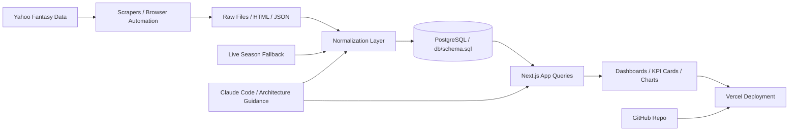

# Building a Fantasy Football Memory Engine with Claude Code: From Historical Data to a Live League Platform

## The idea: turn a league archive into an insight engine

I started this project with a simple but important problem: our fantasy league had years of history, but it lived in scattered files, fragmented spreadsheets, and weekend conversations that were hard to trust or reproduce. We had champions, long losing streaks, playoff runs, draft mistakes, and season narratives—yet there was no single place where owners could quickly answer a basic question like:

- Who is the all-time leader in points?
- Who has the highest win percentage in a given season?
- How did a manager’s trajectory change over time?
- Which teams surged or collapsed in the middle of the year?
- How does the current season compare to the historical trend?

Those questions are not just fun trivia. They are the foundation of good league storytelling. For any competitive environment, the ability to see patterns over time changes the way people evaluate performance, debate decisions, and understand the broader context of the league.

I wanted to build something more than a scoreboard. I wanted a system that could turn seasonal data into decisions, narratives, and comparisons.

That became the Chia League app: a historical data dashboard, a storytelling platform, and a preparation layer for future live-season monitoring.

The underlying goal was simple:

- Give league owners historical context immediately.
- Make decisions easier to evaluate against league history.
- Reduce the need to reconstruct season history from memory or random files.
- Create a durable data foundation that can support both historical reporting and future live-season analysis.

This was not an app idea born in a vacuum. It came from a real need in my league: as people asked better questions, the answers became harder to reconstruct because the data was no longer just a spreadsheet—it had become a narrative system.

## Why this mattered

Fantasy football is deeply iterative. Owners make decisions in draft season, waiver windows, trading, and playoff pushes. But the league story is not just a weekly result count. It is a combination of:

- consistency over multiple seasons
- draft value versus team variance
- playoff appearances and championship runs
- momentum over time
- how one season compares to the long arc of league history

The more I thought about it, the more obvious it became: a league like this deserves a data product. Not a static archive, but a living platform that explains the league as a system.

That is where Claude Code changed the shape of the work.

## Using Claude Code to move from concept to committed implementation

One of the biggest surprises in this project was how much clarity and speed came from working with Claude Code as a design and implementation partner. Claude Code was not simply a code generator. It acted as a structured collaborator in the loop:

- helping define the project architecture
- translating business ideas into technical design choices
- reviewing the current data model and asking where the true identity should live
- suggesting the correct schema boundaries for historical versus live-season information
- helping sequence work in a way that kept complexity manageable

In a traditional build, a project like this often stalls at the planning stage because the data model, ingestion pipeline, and user-facing reporting all need to be designed together. With Claude Code, I could iterate quickly on concept, then harden the structure around real data constraints.

The process was practical and iterative:

1. Define the design problem.
2. Decide what “important” meant in the league context.
3. Normalize the schema around a stable identity.
4. Build the historical ingestion pipeline.
5. Create a dashboard layer over the normalized tables.
6. Prepare the live-season fallback path so that the app can continue working when API access is delayed.

The result was a project that felt less like a one-off portfolio build and more like a real data product with a clear underlying model.

## The first key design decision: owner is the stable identity

One of the most important technical ideas in this project was deciding that the owner, not the team name, is the stable identity.

This matters because team names change across years and occasionally within a season. If you key the entire data system around a team label, your historical records become unstable and hard to trust. A manager may rename a team, move from one brand to another, or simply present the team differently over a period of years.

The database schema solves this by separating the concept of:

- owner identity
- team name by season
- weekly matchup results
- player and roster data

This is visible in the schema model, which treats owners as the enduring entity and weekly team records as mutable context. That choice is critical, because the app is not just a scoreboard; it is a longitudinal record of managers across a long time horizon.

The project’s schema reflects this by storing:

- owners
- teams_by_season
- weekly_matchups
- player_weekly_stats
- team_yahoo_ids

This makes it possible to aggregate career stats, season-level rankings, and historical trends without being confused by a team rename or a rebrand.

From a product perspective, this design makes the analytics more trustworthy. From a technical perspective, it prevents data integrity issues that would otherwise show up as duplicate or fragmented ownership records.

## The data architecture: from Yahoo to dashboards

The project is built around a clean separation between raw extraction, normalization, and reporting.

At a high level, the flow is:

Yahoo Fantasy data -> raw scrape / normalized ingestion -> PostgreSQL -> app queries -> Vercel deployment

That distinction matters. A lot of projects fail not because they lack a flashy UI, but because they confuse raw collection with the final product. The work here intentionally separates the pipeline into stages so the app can stay stable even as the source data changes.

### The flow in plain language

1. Yahoo is the source system.
2. A scraper collects raw league and roster data.
3. A normalization step maps that raw output into the app’s schema.
4. The results are loaded into PostgreSQL.
5. The Next.js app reads from Postgres with query functions.
6. The dashboard renders charts, KPI cards, leaderboard views, and season narratives.
7. Vercel hosts the app and serves the results automatically from GitHub.

This is exactly the right pattern for a data product that needs to be durable, explainable, and maintainable.

## Historical data pipeline: the durable foundation

The historical pipeline is a good example of “good enough is not the same as brittle.” The project collects long-run league data and stores it in a normalized database so the app can answer questions across years without recomputing everything on the fly.

The app uses a Postgres schema designed for league analytics:

- owners for stable identities
- teams_by_season for season-level team context
- weekly_matchups for weekly results and points
- player_weekly_stats for roster-level performance and player-level detail

This matters because the dashboards are not just calculating one-off numbers. They are reading across many seasons, many teams, and many records. The schema supports that shape of analysis without making every report a fragile workaround.

The query layer in the app is also important here. Instead of building ad hoc logic across components, the app centralizes key metrics in query functions. That makes the product easier to evolve. It also means the site can tell a clearer story about the league rather than just dumping raw data onto screen.

## Preparing for live-season data without breaking the historical model

A very important part of this project is the current-season fallback pipeline. The project includes a ready-to-activate scraper and normalization layer designed specifically for live-season startup when Yahoo API access is not yet available.

This is a crucial distinction from the historical pipeline:

- Historical data is already normalized and loaded into the app’s schema.
- Live-season data has a different problem: it may be incomplete, may arrive in a changing DOM, and may come in delayed or inconsistent form.

The current-season folder uses a fallback structure that captures the same logic in a modular form:

- browser automation with Playwright
- save browser session state
- collect weekly team pages and roster pages
- normalize into the same schema used by the app
- upsert rows rather than rebuild the model from scratch

This is a strong design pattern because it does not create a second application layer. It keeps the app architecture stable and simply adds another ingestion source feeding the same model.

That is particularly important for a league product because it means the app can continue to function as a single source of truth even during early-season disruption. The fallback is built specifically so the site does not need to know whether the data came from historical files or a new live scrape. It only needs the normalized row model.

## Why the project uses the technology it does

### Next.js + TypeScript

I chose Next.js with TypeScript because this is a full-stack product with both an application layer and a data layer. I wanted a framework that supports routing, server-side rendering, and a modern UI structure while still fitting naturally into a data-driven product.

TypeScript matters here because the app is not a toy demo. It has multiple layers of logic, and type safety helps preserve confidence when working with season data, query result shapes, and repeated dashboard patterns.

### Postgres for the source of truth

Postgres is a good fit for this project because the data is relational, hierarchical, and cross-season in nature. Historical data, weekly matchups, seasonal team records, and player stats all fit a schema that emphasizes relationships rather than flat JSON blobs.

The schema also makes it easier to maintain truth over time. A manager’s identity remains stable while team names and data points vary. That is a classic relational modeling problem, and Postgres is well suited for it.

### Vercel for hosting and deployment

Vercel was the natural production choice because the app is a Next.js project and the repo is designed to deploy directly from GitHub. This keeps deployment simple and aligned with how modern web products are shipped: push, deploy, verify.

This also matters because it reduces operational drag. The project is easier to maintain when deployment is mostly automatic and the app remains natively aligned with the framework.

### GitHub for versioning and decision history

GitHub is not just storage—it is a decision log. For a project like this, version control matters because the app is iterative and structural. The project evolves through changes to schema, data ingestion, analytics logic, and UI design. Having that history in Git makes it easier to reason about the project and roll back when one pipeline change creates unintended side effects.

### Playwright for live-season fallback

Playwright matters in the current-season fallback because the data source is browser-driven and often changes. When the league pages and team pages are not directly exposed through a clean API, browser automation becomes the realistic way to capture the current state.

This is also a useful design point: even in a modern app, browser automation still provides a pragmatic bridge when data access remains under-managed or delayed.

## The real product story: not just data, but storytelling

The final app is more than a table of values. It tells a story about the league.

The home page combines:

- KPI cards
- season-over-time charts
- manager leaderboards
- team name visualizations
- player network context

This matters because storytelling is often the difference between data and insight. League owners do not just want raw numbers; they want a way to understand the shape of the league.

The app also includes a seasonal navigation flow and a “live 2026 season” holding state, which is a subtle but important design choice. It tells the user that the product is prepared for the future without pretending that data is available before it exists.

That kind of product honesty matters. It tells the user that the system is ready for deployment when the season starts, but deliberately avoids presenting incomplete live data as if it were historical truth.

## The crucial design choices that mattered most

If I had to pull out the three most important design choices, they would be these:

1. Stable identity over changing labels.
   The owner stays constant; team names do not.

2. Separate raw extraction from normalized data.
   The app should never have to care whether data came from a historical run or a live scrape.

3. Build for future live data without breaking the historical architecture.
   The app is designed to absorb future season data gracefully rather than force a second system to emerge.

These choices made the project feel intentional rather than improvised.

## Why this project matters beyond the league

This project is a useful case study for a broader class of problem: building a data product when your source system is messy, fragmented, or not built for analytics.

The same pattern appears in many business contexts:

- data spread across multiple files or systems
- sources that are not fully structured
- an urgent need for a historical narrative layer
- an eventual requirement to bring in near-real-time monitoring
- a need to move from raw source data to decision-making systems

The real lesson is that the value is not just in scraping data. The value is in creating a durable foundation that answers real questions over time.

That is what this project ultimately became: a data product built around a stable identity model, a normalized warehouse, and a reporting layer that helps people see insight instead of just inventory.

## Conclusion

What started as a practical need for league history became a much bigger and more valuable project: a system that could document, visualize, and prepare for league performance over time.

Claude Code helped turn an idea into something structured, testable, and maintainable. The architecture intentionally separates collection, normalization, storage, and reporting. The data model makes the league stable even where names and teams are not. And the live-season fallback ensures the app is ready for the next cycle without breaking the historical foundation.

This project is a good example of what happens when a person combines domain understanding with a disciplined data architecture. The result is not just a fantasy football app. It is a durable, story-driven analytics platform built from the actual realities of the league itself.

For anyone working with messy data, fragmented sources, or the challenge of creating a decision-support product from raw histories, this project offers a useful model: build the identity correctly, normalize early, prepare for future sources, and let the product tell the story the data supports.

---

## Optional quick take for a blog intro

If you want a shorter opening paragraph for the article, you could use this:

> I wanted a better way to understand our fantasy league than a pile of spreadsheets and scattered season notes. Claude Code helped me turn that idea into a real application: a historical dashboard, a live-season fallback pipeline, and a durable data model that tracks league storylines over time. In the process, I learned how much value comes from building the system correctly at the start—especially when your source data is messy, your identities are unstable, and your users need answers faster than they can reconstruct them from memory.

## Data pipeline diagram



## A simple visual concept for supporting graphics

You can also use a simple supporting graphic in a presentation or blog post showing a three-layer model:

- Source data
- Normalized league model
- Product layer

This is the core pattern the project follows.

```text
Yahoo Fantasy
      |
      v
Raw scrape / browser collection
      |
      v
Normalize + map to schema
      |
      v
Postgres (owners, teams, matchups, player stats)
      |
      v
Next.js dashboards + league storytelling
      |
      v
Vercel deployment
```

## Suggested blog angle

This work is especially compelling to data leaders and analytics professionals because it demonstrates:

- good data modeling under uncertainty
- schema design that respects real-world identity changes
- a practical ingestion pipeline that scales from historical data to future live updates
- product design that treats the data as a story, not just a table
- the value of using AI assistance to accelerate a real architecture conversation

That is the message I would emphasize in the article.
